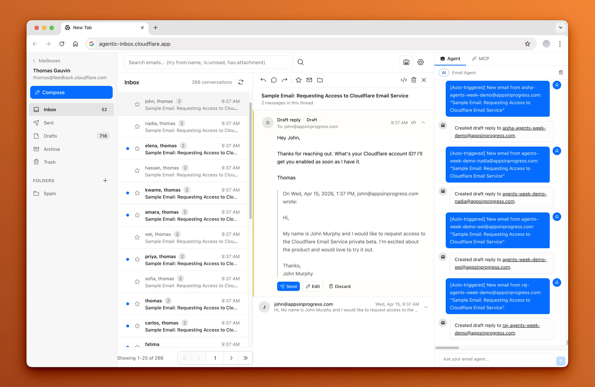

[](https://deepwiki.com/schmug/PhishSOC)
<div align="center">
  <h1>PhishSOC</h1>
  <p><em>A self-hosted email client with a phishing SOC built in, running entirely on Cloudflare Workers.</em></p>
</div>

PhishSOC is a complete webmail client (inbox, threading, composer, search, attachments) where every inbound message can be scored by a layered security pipeline before it reaches you, and every risky outbound message needs a passkey to leave. It runs as a single Cloudflare Worker: mail arrives through [Cloudflare Email Routing](https://developers.cloudflare.com/email-routing/), each mailbox lives in its own [Durable Object](https://developers.cloudflare.com/durable-objects/) with a SQLite database, attachments go to [R2](https://developers.cloudflare.com/r2/), and the whole app sits behind [Cloudflare Access](https://developers.cloudflare.com/cloudflare-one/policies/access/).

On top of the mail client you get:

- **Inbound phishing detection.** SPF/DKIM/DMARC, URL and homograph heuristics, sender reputation and impersonation detection, threat-intel feeds, an LLM classifier, and an async deep scan (redirect chains, domain age, IP reputation, attachments). Every email shows its verdict and why.
- **Outbound send-risk gating.** Drafts are classified into risk tiers; risky sends require a WebAuthn passkey step-up, and the riskiest also need a typed confirmation.
- **SOC workflow.** Report-as-phish, cases, a per-mailbox dashboard, sender blocklists, false-positive labels, and an optional community threat-intel hub.
- **AI agents.** A per-mailbox agent that reads, triages and drafts replies (never sending without confirmation), an org-wide agent, and an [MCP](https://modelcontextprotocol.io/) server so Claude Code, Cursor and other MCP clients can work your mailboxes.
- **Domain posture.** DMARC, SPF, DKIM, MTA-STS, BIMI, TLS-RPT and DNSSEC posture per domain, plus DMARC and TLS-RPT report ingest.
- **Deployment modes.** Use it as your mailbox, as an inline gateway in front of Google Workspace or M365, or as a sidecar that scores an existing Workspace mailbox without touching MX.



PhishSOC started as a fork of Cloudflare's [agentic-inbox](https://github.com/cloudflare/agentic-inbox) ([Email for Agents](https://blog.cloudflare.com/email-for-agents/)). For a folder-by-folder orientation of the repo, see the [Codebase map](./CLAUDE.md#codebase-map).

## Contents

- [Features](#features)
- [Deploying](#deploying)
- [Connecting an MCP client](#connecting-an-mcp-client)
- [Local development](#local-development)
- [Security pipeline](#security-pipeline)
- [Architecture](#architecture)
- [Documentation](#documentation)

## Features

### Email client

- Send and receive through Cloudflare Email Routing and Email Service, with a rich-text composer, reply/forward threading, folders, search, and attachments.
- Multiple domains and mailboxes per deployment, plus an **All inboxes** view across every mailbox you can see and org-wide search.
- Per-mailbox isolation: each mailbox is a Durable Object with its own SQLite database and R2 attachment storage.
- Layered settings: org, domain, and mailbox tiers. Unset values inherit from the tier above.
- Per-mailbox access control (members and Access groups), ownership transfer, and a one-click lock-down for unscoped mailboxes.
- Optional new-mail webhooks (Google Chat / Slack style, or JSON) per org, domain, or mailbox, optionally HMAC-signed.

### Inbound security

- Opt-in security pipeline (see [Security pipeline](#security-pipeline)) that can be enabled per mailbox or at the domain/org tier.
- Every email shows its verdict, score, reasons, and a per-stage trace of what ran.
- Verdicts map to actions: allow, tag, quarantine, or block, with learning mode (never quarantines) and confidence-aware demotion.
- Sender blocklist at mailbox, domain, or org scope that drops silently, bounces, or moves to Spam.
- **Not phish** button that records a false-positive label without changing the verdict.
- Optional YARA attachment scanning through the [YaraMail sidecar](docs/yaramail-sidecar.md).
- Catch-all scoring for mail sent to non-existent addresses on your domains, with directory-harvest alerts.
- [Honeypot mailboxes](docs/honeypots.md): burner addresses that publish IOCs to the hub and never reply.

### Outbound safety

- Every send is classified into Tier 0 (no friction), Tier 1 (passkey step-up), or Tier 2 (step-up plus typed confirmation). Signals include external recipients, lookalike domains, BEC/credential language, risky attachments, replies to quarantined mail, and an outbound LLM check.
- Step-up is an app-layer WebAuthn assertion bound to the payload and to the Cloudflare Access identity. See [docs/step-up-auth.md](docs/step-up-auth.md).
- Agent-authored drafts are bumped a tier, and the agent cannot send without explicit confirmation.

### SOC workflow

- **Report phish** turns an email into a case. Cases track status, indicators of compromise, and an AI summary, and can be shared to the hub.
- Per-mailbox **dashboard**: threats blocked, open cases, pipeline health and latency, verdict mix, and hub activity.
- Analyst-confirmed **Submit to Cloudflare** phishing categorization of a domain from a case (optional; needs an Intel API token, with a never-submit list and a monthly cap).
- A MISP-compatible [community threat-intel hub](hub/) that accepts reports from many deployments and publishes a trust-weighted, corroborated destroylist feed.
- Security alerts to an operator webhook (`SECURITY_ALERT_WEBHOOK_URL`) for high-risk events such as a first passkey enrollment or a gateway relay failure.

### AI agents

- **Mailbox agent** side panel with 9 tools (list, read, search, thread, draft, update draft, mark read, move, send). Auto-drafts replies to new mail, always requiring confirmation to send. Custom system prompt per mailbox, persistent chat history, streaming responses.
- **Org agent** with org-wide tools: overview, top threats, and case search across mailboxes.
- **MCP server** at `/mcp` with 13 tools: `list_mailboxes`, `list_emails`, `get_email`, `get_thread`, `search_emails`, `create_draft`, `update_draft`, `draft_reply`, `send_email`, `send_reply`, `mark_email_read`, `move_email`, `delete_email`.
- The agents never see analyst-only actions (URL scanning, Cloudflare categorization) so injected email content can't trigger them. See [SECURITY_SPEC.md](SECURITY_SPEC.md).
- Models are configurable. The default agent model is Workers AI `@cf/moonshotai/kimi-k2.5`.

### Domain posture and reports

The domain page (`/domains/:domain`) shows DMARC policy and alignment, SPF (including a 10-lookup check), DKIM, MTA-STS, BIMI, TLS-RPT, and DNSSEC. DMARC aggregate (RUA) and forensic (RUF) reports and TLS-RPT reports sent to a PhishSOC mailbox are ingested and charted.

### Deployment modes

| Mode | What it does | Guide |
| --- | --- | --- |
| Standalone (default) | PhishSOC is the mailbox. Email Routing delivers to the Worker, which stores and scores mail. | [Deploying](#deploying) |
| Inline gateway | PhishSOC scores inbound mail, then relays it to Google Workspace, M365, or any SMTP-submission backend with verdict headers and an ARC seal. Quarantined mail is held. | [docs/gateway-mode.md](docs/gateway-mode.md) |
| Workspace sidecar | Polls existing Google Workspace mailboxes through the Gmail API and scores them, with no MX change. | [docs/sidecar-credentials.md](docs/sidecar-credentials.md) |

## Deploying

**Important:** the Deploy button is only part of setup. Finish the steps after it, or the app will refuse requests.

### Prerequisites

- A Cloudflare account with a domain
- [Email Routing](https://developers.cloudflare.com/email-routing/) for receiving and [Email Service](https://developers.cloudflare.com/email-service/) for sending
- [Workers AI](https://developers.cloudflare.com/workers-ai/) (agents and the LLM classifier)
- [Cloudflare Access](https://developers.cloudflare.com/cloudflare-one/policies/access/) (required in production)

### Steps

1. **Deploy to Cloudflare.** The deploy flow provisions R2, Durable Objects, KV, D1, and Workers AI. You'll be prompted for **DOMAINS**, your Email Routing domain(s), comma-separated (e.g. `example.com` or `a.example,b.example`).

   [](https://deploy.workers.cloudflare.com/?url=https://github.com/schmug/PhishSOC)

2. **Configure Cloudflare Access.** Enable [one-click Cloudflare Access](https://developers.cloudflare.com/changelog/post/2025-10-03-one-click-access-for-workers/) on the Worker under Settings > Domains & Routes. Set the `POLICY_AUD` and `TEAM_DOMAIN` values it shows as Worker secrets. `TEAM_DOMAIN` can be the Access team URL or the full `.../cdn-cgi/access/certs` URL.
3. **Set the WebAuthn relying party.** Set `RP_ID` (e.g. `inbox.example.com`) and `RP_ORIGIN` (e.g. `https://inbox.example.com`) in `wrangler.jsonc` `vars` to your deployed hostname, apply the D1 migrations (`wrangler d1 migrations apply phishsoc-webauthn --remote`), and set `CONFIRMATION_TOKEN_SECRET` (`openssl rand -hex 32`). Without these, risky sends cannot be confirmed. See [docs/step-up-auth.md](docs/step-up-auth.md).
4. **Set up Email Routing.** In your domain's Email Routing, create a catch-all rule that sends to this Worker.
5. **Enable Email Service** so the `send_email` binding can send from your domain(s). See the [Email Service docs](https://developers.cloudflare.com/email-service/).
6. **Create a mailbox.** Open the app and create a mailbox for any address on your domain (e.g. `hello@example.com`).
7. **Turn on the security pipeline** in Settings → Security, and set the [recommended configuration](#recommended-configuration).

For a walkthrough with screenshots of the deploy, Email Routing, and Access steps, see the [upstream setup guide](https://github.com/cloudflare/agentic-inbox/issues/4#issuecomment-4269118513); those steps apply to PhishSOC unchanged.

Optional integrations (CrowdSec CTI, hub credentials, webhooks, Cloudflare Intel, gateway relay credentials) are all Worker secrets. Every one is listed, with its effect when missing, in [docs/secrets.md](docs/secrets.md).

### Deploying from a clone

`wrangler.jsonc` contains the maintainer's own resource IDs and hostnames. Replace them with yours before `npm run deploy`:

```bash
wrangler r2 bucket create agentic-inbox
wrangler kv namespace create BLOOM_KV            # paste the id into wrangler.jsonc
wrangler d1 create phishsoc-webauthn             # paste the database_id into wrangler.jsonc
wrangler d1 migrations apply phishsoc-webauthn --remote
```

Then update `DOMAINS`, `RP_ID`, and `RP_ORIGIN` in `vars`, set the secrets above, and run `npm run deploy`.

### Troubleshooting Access

- **`Invalid or expired Access token`** usually means `POLICY_AUD` or `TEAM_DOMAIN` is wrong. [Turn Access off and on again](https://developers.cloudflare.com/changelog/post/2025-10-03-one-click-access-for-workers/) for the Worker to see the modal, then reset both secrets.
- **`Cloudflare Access must be configured in production`** means the secrets are missing. PhishSOC refuses to serve without Access so your inbox is never exposed to the internet.

### Access model

Cloudflare Access is the trust boundary for everything, including `/mcp`. Anyone who passes your Access policy can use the app. Two layers narrow that:

- **Mailbox ACLs** limit which people and Access groups can open a given mailbox. A mailbox with no ACL is open to everyone behind Access.
- **WebAuthn step-up** requires a passkey assertion, tied to the Access identity and the exact message, before a Tier 1+ send.

Access service tokens carry no email identity, so they can only reach mailboxes with no ACL. The threat model is in [docs/security/THREAT_MODEL.md](docs/security/THREAT_MODEL.md).

## Connecting an MCP client

The MCP server is served over Streamable HTTP at `https://<your-host>/mcp`, behind the same Cloudflare Access application as the app.

1. In Cloudflare Zero Trust, create a **service token** (Access → Service Auth) and add a policy with the **Service Auth** action that includes that token on the PhishSOC Access application.
2. Register the server with your client, passing the token as headers. For Claude Code:

   ```bash
   claude mcp add --transport http phishsoc https://inbox.example.com/mcp \
     --header "CF-Access-Client-Id: <client-id>.access" \
     --header "CF-Access-Client-Secret: <client-secret>"
   ```

3. Ask the client to `list_mailboxes` to confirm it works.

Because a service token has no email identity, MCP clients see only mailboxes without an ACL. ACL-scoped mailboxes stay private to their members. MCP sends go through the same send-risk checks as the UI.

## Local development

```bash
npm install
npm run dev        # local dev server; Cloudflare Access is skipped
npm test           # Vitest: workers + frontend
npm run typecheck  # wrangler types + react-router typegen + tsc
```

The dev server runs with local-only bindings and seeds a synthetic `dev@localhost` identity, so no Access token is needed. The `send_email` binding is a no-op locally. Copy `.dev.vars.example` to `.dev.vars` for optional local secrets. See [docs/testing.md](docs/testing.md) for the test layout and [CONTRIBUTING.md](CONTRIBUTING.md) for the PR flow.

### Optional: remote bindings locally

To route `send_email` to the deployed Worker, install [direnv](https://direnv.net/) and create a gitignored `.envrc`:

```bash
# .envrc — DO NOT COMMIT (already in .gitignore)
export CLOUDFLARE_ACCESS_CLIENT_ID=<your token>.access
export CLOUDFLARE_ACCESS_CLIENT_SECRET=<your secret>
```

Run `direnv allow .`. Vite enables the remote-binding proxy when these are set and passes `remoteBindings: false` otherwise.

### Two-domain end-to-end test

1. Put two domains in `DOMAINS` and enable Email Routing (catch-all to the Worker) and Email Service on both.
2. Create one mailbox per domain and send from one to the other. This exercises outbound send, inbound routing, pipeline scoring, auto-draft, and reply.
3. Turn the security pipeline on for at least one mailbox and set **Trusted authentication servers** to `mx.cloudflare.net` first.

## Security pipeline

The pipeline is **opt-in**. Existing mailboxes are unaffected until you enable it in Settings → Security (per mailbox, or at the domain/org tier to cover every mailbox beneath it).

### Recommended configuration

Both settings live in Settings → Security and are empty by default.

**1. Trusted authentication servers.** Only `Authentication-Results` headers from these authserv-ids are trusted. Without this list, an upstream server can forge `spf=pass; dkim=pass; dmarc=pass`. For a Cloudflare-routed setup use `mx.cloudflare.net`; add forwarders on your path (suffix match, so `google.com` covers `mx1.google.com`):

```
mx.cloudflare.net, google.com, outlook.com
```

**2. Business hours (optional).** Mail outside your hours gets +10, since BEC and wire-fraud requests cluster at night and on weekends. It can tip a borderline verdict but never quarantines on its own. Takes an IANA timezone, a start hour, an exclusive end hour, and an optional weekdays-only flag.

### Stages

| Stage | Latency | Notes |
| --- | --- | --- |
| Sender blocklist | µs | Before storage. Mailbox > domain > org precedence; drop, bounce, or Spam |
| Auth parse | µs | SPF/DKIM/DMARC from `Authentication-Results`, gated by trusted authserv-ids; sender trust is bound to the DMARC-evaluated From domain |
| URL extract + heuristics | ms | Homograph/Levenshtein against high-value domains, shorteners, and own-domain lookalikes (sender and link domains imitating your domains, up to +25) |
| Threat-intel feeds | ms | Bloom-filter lookup of canonicalized URLs/hosts against [feeds](workers/intel/feeds.ts) (URLhaus, PhishDestroy, and configurable feeds); hits in 2+ feeds floor the score at quarantine |
| Sender reputation | ms | Rolling per-mailbox score, flagged-sender fast path, CrowdSec prior for first-time senders, and display-name impersonation detection (up to +30) |
| Triage short-circuits | µs | Hard block on confirmed intel or flagged sender; hard allow on DMARC pass plus allowlist or trusted history |
| LLM classifier | seconds | Workers AI model (configurable), or the opt-in Cloudflare Clef or TypeSafe Jev backends with fallback. Timeout contributes 0; a parse error fails closed to `suspicious` ([SECURITY_SPEC.md Rule 5](SECURITY_SPEC.md)) |
| Verdict aggregation | µs | Thresholds per settings tier; off-hours, impersonation, lookalike, and intel boosts; learning mode and confidence demotion |
| **Async deep scan** | seconds | `ctx.waitUntil`, after the verdict is stored. Can only tighten the verdict, capped at +40 |
| YARA sidecar | ≤30s | Optional, async, never on the critical path |

### Async deep scan

- **Redirect-chain resolution** follows up to 5 hops so later checks see the real destination.
- **RDAP domain age**: under 7 days +20, under 30 days +10.
- **CrowdSec CTI** (optional, `CROWDSEC_CTI_API_KEY`): redirect-target IPs resolved over DoH and checked for phishing/exploit behaviors and malicious reputation. Capped at +25, cached 12h in KV.
- **Spamhaus DROP/EDROP**: refreshed every 12h by cron; redirect-target IPs in a listed CIDR add +20.
- **CrowdSec community blocklist**: an operator-configured IP feed (`intel.feeds`, with an `auth_secret`) on the same path as DROP/EDROP.
- **Attachment heuristics**: dangerous and macro-enabled types, double extensions, MIME/extension mismatch, payload-advertising archives.

### Threat-intel hub

[`hub/`](hub/) is a separate MISP-compatible Worker. Deployments push phishing reports and honeypot IOCs to it and pull corroborated indicators back as a feed. Corroboration is trust-weighted, so one org can't promote its own intel alone. Hub and feed credentials are only sent to hosts on `HUB_ALLOWED_HOSTS` / `FEED_ALLOWED_HOSTS`.

## Architecture

```
                      ┌──────────── Cloudflare Access (JWT) ────────────┐
┌─────────────┐       │  ┌──────────────────────┐    ┌───────────────┐  │
│ Browser SPA │──────────│  Hono Worker         │───>│ MailboxDO     │  │
│ MCP clients │──────────│  /api/v1  /mcp       │    │ SQLite + R2   │  │
└─────────────┘       │  │  /agents  SSR        │    └───────────────┘  │
                      │  │                      │───>│ EmailAgent DO │  │
Email Routing ──────────>│  email()  security   │    │ OrgAgent DO   │  │
                      │  │  pipeline, deep scan │    │ EmailMCP DO   │  │
Cron (1m / 1h) ─────────>│  scheduled()         │    │ CatchallIntel │  │
                      │  └──────────┬───────────┘    └───────────────┘  │
                      └─────────────┼───────────────────────────────────┘
                                    ├──> Workers AI   (agents, classifier)
                                    ├──> KV  BLOOM_KV (feeds, caches, quotas)
                                    ├──> D1  WEBAUTHN_DB (passkeys)
                                    ├──> Email Service / SMTP relay (outbound)
                                    └──> Optional: YaraMail sidecar, hub, Gmail API
```

The minutely cron polls Workspace sidecar mailboxes. The hourly cron refreshes intel feeds and reaps expired honeypots, WebAuthn challenges, and sidecar bodies.

**Stack:** React 19, React Router v7, Tailwind CSS, TanStack Query, Zustand, TipTap, `@cloudflare/kumo` on the frontend; Hono, Workers, Durable Objects (SQLite), R2, KV, D1, Email Routing and Email Service on the backend; Cloudflare Agents SDK and AI SDK v6 for the agents.

## Documentation

| Document | Covers |
| --- | --- |
| [SECURITY_SPEC.md](SECURITY_SPEC.md) | Rules for agent-safe email pipelines: prompt-injection and async-pipeline invariants this code enforces |
| [docs/security/THREAT_MODEL.md](docs/security/THREAT_MODEL.md) | Threat model |
| [docs/step-up-auth.md](docs/step-up-auth.md) | WebAuthn step-up for risky sends: setup, D1, recovery, testing |
| [docs/secrets.md](docs/secrets.md) | Every Worker secret: purpose, storage, rotation, behavior when missing |
| [docs/gateway-mode.md](docs/gateway-mode.md) | Inline gateway relay to Workspace/M365 |
| [docs/sidecar-credentials.md](docs/sidecar-credentials.md) | Workspace sidecar service account setup and rotation |
| [docs/yaramail-sidecar.md](docs/yaramail-sidecar.md) | YARA attachment scanner deployment and interface |
| [docs/honeypots.md](docs/honeypots.md) | Honeypot mailboxes |
| [docs/testing.md](docs/testing.md) | Test layout and CI |
| [docs/security-policies.md](docs/security-policies.md) | Dependabot/CodeQL remediation SLAs and merge gates |
| [docs/support.md](docs/support.md) | Release support policy |
| [.github/SECURITY.md](.github/SECURITY.md) | Reporting a vulnerability |

## Versioning and support

PhishSOC uses [Semantic Versioning](https://semver.org/). Changes are tracked in [`CHANGELOG.md`](CHANGELOG.md), generated by [git-cliff](https://git-cliff.org/) from conventional commits. Support windows are in [docs/support.md](docs/support.md).

## Contributing

See [CONTRIBUTING.md](CONTRIBUTING.md) for the fork, branch, and PR flow, tests, commit format, and DCO sign-off. Governance and maintainer contacts are in [MAINTAINERS.md](MAINTAINERS.md).

## License

Apache 2.0. See [LICENSE](LICENSE).
